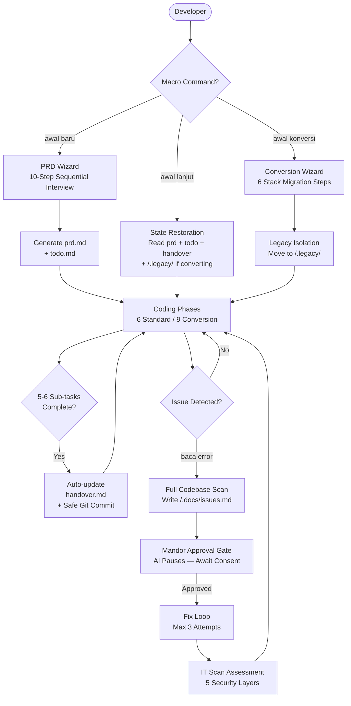

<div align="center">

# 🧠 Brainvibes

### _Global AI Coding Configuration System_

**Configuration & Standardization Framework for AI Coding Agents**

[](https://github.com/Noisesless/brainvibes)
[](https://github.com/google-gemini/gemini-cli)
[](#)
[](#)
[](LICENSE)

---

*A global Markdown-based instruction framework designed to standardize architectural governance,*
*application security, token-driven visual consistency, and context management across AI coding agents.*

</div>

---

## What is Brainvibes?

**Brainvibes** is a Markdown-based configuration and governance framework for AI coding agents (such as Google Gemini CLI, Antigravity IDE, Cursor, and GitHub Copilot). It establishes interaction protocols, project architectural standards, application security controls, token-based visual consistency, and structured workflows automatically loaded across every session without requiring manual reconfiguration.

---

## Ecosystem Structure

### Core Files & Tooling

| File / Directory | Size | Purpose |
| :--- | :--- | :--- |
| [`gemini.md`](gemini.md) | ~32KB | **Core System Instructions** — Global agent rules, session protocols, main switches, visual & security gates, context budget management, and response formatting. |
| [`gemini-execution.md`](gemini-execution.md) | ~55KB | **Technical Execution Guide** — Code standardization, modular architecture, upload pipeline, §3.B.7 Dual-Mode Handover Engine, §4.K Tiered Visual Design Pipeline, §4.O Pragmatic Output, and pre-flight validation. |
| [`gemini-templates.md`](gemini-templates.md) | ~32KB | **Templates & Macro Commands** — Detailed execution flows for 11 macro commands (§2A-§2K), `issues.md` debug tracker, 5-stage Git sanitization workflow, and handover specifications. |
| [`prd-template.md`](prd-template.md) | ~29KB | **PRD Template** — Standard 11-chapter Product Requirement Document, immutable core constraints, and architectural specifications. |
| [`design-system.md`](design-system.md) | ~70KB | **Design System** — CSS token specifications (oklch), layer architecture, typography pairing, 32-component UI token registry (§7B), and 7-tier responsive strategy (Android 3M + Laptop-First 1366×768). |
| [`AGENTS.md`](AGENTS.md) | ~0.2KB | **Workspace Pointer** — Lightweight pointer for Antigravity IDE to prevent redundant 18K token global rule loading at the repository root. |
| [`AGENTS.global.md`](AGENTS.global.md) | ~4KB | **L1 Global Dispatcher** — In-memory fast routing table (11 switches), Git drift detection, dynamic multi-platform fallback resolver, and Browser Tool Gate. |
| [`anti-bloat-code.md`](.agents/rules/anti-bloat-code.md) | ~13KB | **Anti-Bloat & Pragmatic Output Rule** — §0 Satu Aturan (*Diam jika oke, bicara jika error*), §1.B Pattern-based blocklist, §2.B View anti-bloat, §2.C Area abu-abu (komentar/log/commit), dan arsitektur YAGNI pragmatis. |
| [`COPY_RULES.md`](config/skills/taste-skill-bridge/COPY_RULES.md) | ~15KB | **UI Microcopy & Anti-Tech-Leak SSOT** — Single source of truth teks UI, Gate 5B `[COPY TABLE]`, batas kata, blocklist EN+ID, §4.B Pattern blocklist, §4.C TechLeak expanded, §4.D Infra Status Badge Ban, §4.E Anti Literal Prompt Echo (Echo Test <2 kata), dan 7-filter lint regex. |
| [`user-prefs.md`](user-prefs.md) | ~7KB | **User Preferences** — Port defaults, visual themes, agent behavior toggles, context7 whitelists, response styles, and web search configurations. |
| [`config/mcp_config.json`](config/mcp_config.json) | ~0.5KB | **MCP Configuration** — Hybrid dual-schema configuration (`mcpServers` stdio for Antigravity IDE & `mcp` for Gemini CLI: codebase-memory + context7). |
| [`sync.ps1`](sync.ps1) & [`sync.sh`](sync.sh) | ~7KB | **Synchronization Scripts (Dual-Platform)** — Automated deployment to `~/.gemini/` (Windows PowerShell & Unix Bash), configuring MCP servers, global rules, and verifying CBM daemon. |
| [`scripts/`](scripts/) | ~6KB | **Automation Scripts** — Automation helpers for CBM daemon management (`ensure-cbm-daemon`), project repository indexing (`index-project`), and IDE lifecycle hooks (`cbm-hook`). |
| [`.gitattributes`](.gitattributes) | ~0.3KB | **Git Attributes** — Normalizes line endings across platforms (LF for shell/markdown/json, CRLF for PowerShell). |
| `LICENSE` | ~36KB | MIT License. |
| `WORKFLOW_SIMULATIONS.md` | ~15KB | **Workflow Simulations** — Scenarios, runbooks, and test logs for macro command execution. |

### Skills System (12 Modular Skills)

| Skill | Trigger Keywords | Purpose |
| :--- | :--- | :--- |
| `ui-ux-pro-max` | awal baru, redesign | **UUPM v2.15.0** — Design intelligence engine with 18 datasets (192 color palettes, 79 UI styles [50 active, 29 supplemental, 9 deprecated], 74 font pairings, 1,934 approved Google Fonts, 192 reasoning profiles, 119 UX guidelines, 1,260 stack guidelines across 22 stacks, 17 GSAP motion presets, 25 chart types), BM25 query routing, resilient text layout guidance, Three Dials CLI (`--variance`/`--motion`/`--density`), `reasoning_contract.py`, and automated schema validation. |
| `taste-skill-bridge` | buat halaman, landing page, UI baru, ubah bentuk, ubah tampilan, ubah layout, perbaiki halaman, redesign visual, ubah visual | Frontend anti-slop bridging integrating **tasteskill v2** (study of 247 curated sites: anti-thin-rules, anti-resting-shadows, anti-assistant-palette, complete em-dash ban, required real photography), Three Dials enforcement, and microcopy SSOT (`COPY_RULES.md`). |
| `security-patterns` | cek komponen, cek kom, audit security, cek kelengkapan | Stack-specific vulnerability database and secure coding patterns (30 Security Patterns, 5 XAMPP PHP Patterns, 5-Tier Adaptive Rate Limiter, 100% OWASP Top 10:2025 coverage). |
| `code-snippets` | buat form, buat navbar, buat modal | Production-ready UI component library and secure authentication snippets adhering to token standards. |
| `database-patterns` | desain database, migration | Database schema design guidelines, ACID transactional data migrations, indexing strategies, and query/ORM optimization. |
| `lessons-learned` | baca error, jangan ulangi | Repository of battle-tested solutions and prevention records for recurring errors across completed projects. |
| `pentest-strix` | pentest, pentest cepat, dast | Dynamic Application Security Testing (DAST) leveraging the containerized Strix penetration testing agent to validate exploits. |
| `accessibility-audit` | audit a11y, WCAG | Web accessibility compliance checklist covering WCAG 2.2 AA standards and assistive navigation. |
| `performance-audit` | audit performa, lighthouse | Web performance optimization and Core Web Vitals audit procedures. |
| `deployment-checklist` | deploy, hosting, go live | Pre-flight release checklists across hosting platforms (cPanel, Vercel, VPS Nginx, Netlify). |
| `git-workflow` | commit, push, branch | Version control management protocols, secret sanitization, and Conventional Commits enforcement. |
| `quick-scaffold` | buat komponen, buat model, buat controller | Rapid boilerplate generator for components, models, controllers, and routes per stack. |

### Smart Skill Integration (SSI) System

Brainvibes includes the **Smart Skill Integration (SSI)** subsystem to automatically detect, validate dependencies, and integrate supplementary skills into `config/skills/` without manual registry edits.

**Integration Lifecycle:**
```
1. Add new skill directory to config/skills/<skill-name>/
2. Registered skill scan executed during session initialization
3. 5-point conflict & dependency validation checklist
4. Integration recommendations & trigger consolidation
5. Automated metadata indexing in .skill-index.json
```

**Key Capabilities:**
- **Auto-Detection:** Monitors additions to `config/skills/`.
- **Dependency & Gap Verification:** Checks trigger overlaps, dataset availability, execution logic, and naming collisions.
- **Trigger Consolidation:** Unifies trigger keywords into `AGENTS.global.md` without destructive overwrites.
- **Centralized Registry:** Keeps `.skill-index.json` updated with versions, paths, and status.

> Reference: `config/skills/integration-checker.md`

### Codebase Analysis & Graph Dependencies (`codebase-memory-mcp`)

Brainvibes natively integrates **`codebase-memory-mcp`** (CBM v0.10.8) for AST-based graph dependency analysis and semantic code search:

- **15 Graph Tools:** In-depth code intelligence via `index_repository`, `search_graph`, `query_graph`, `trace_path`, `get_code_snippet`, `get_architecture`, `detect_changes`, and `manage_adr`.
- **Interactive 3D Web UI:** Browser-based 3D dependency graph visualizer accessible at `http://localhost:9749/`.
- **IDE Lifecycle Automation:** `PreInvocation` hook (`hooks.json`, `cbm-hook.sh` / `cbm-hook.ps1`) ensuring the background CBM daemon is operational.
- **Indexing Utilities:** Fast workspace indexers (`scripts/index-project.sh` / `scripts/index-project.ps1`).
- **Synchronization Verification:** Port availability and dependency integrity verified automatically during `sync.sh` / `sync.ps1`.

### Knowledge Items (3 Local Knowledge Bases)

| Knowledge Base | Contents | Purpose |
| :--- | :--- | :--- |
| `error-solutions/` | 4 guides (PHP, Next.js, CSS oklch, XAMPP) | Battle-tested error fixes from real environments — loaded during `baca error`. |
| `project-retrospectives/` | 1 retrospective + template | Post-mortem engineering analysis — loaded during `awal baru` Knowledge Priming. |
| `vibes-stack-patterns/` | 3 pattern guides (PHP, Next.js, CSS) | Verified implementation patterns — loaded silently during feature development. |

### Standard Documentation (/.docs/ — 9 Files)

Brainvibes enforces a **9-file technical documentation standard** required for every generated project (`/.docs/`):

| # | File | Contents | Brainvibes Status |
|---|---|---|---|
| 1 | `architecture.md` | Macro architecture, layer separation (Presentation/Logic/Data), loading protocols, token efficiency strategy | Active |
| 2 | `api-spec.md` | MCP server endpoints (codebase-memory, context7), macro triggers, data flows | Active |
| 3 | `database.md` | Schema templates, runtime storage definitions (JSON-based state), indexing strategies | Active |
| 4 | `dependency-graph.md` | Critical files (`gemini.md`, `user-prefs.md`, `AGENTS.md`), high-impact files, leaf files, import chains, circular dependency checks | Active |
| 5 | `deployment.md` | Target deployments, environment mappings, pre-deploy checklists, build commands, rollback plans | Active |
| 6 | `issues.md` | Bug tracker — open issues, resolved history (FIFO max 10), severity classifications | Active |
| 7 | `quality_review.md` | Code quality metrics (file counts, size distribution), linting validation, complexity analysis, duplication metrics | Active |
| 8 | `routes.md` | Frontend and API routes, middleware chains, lifecycle statuses (active/beta/planned/deprecated) | Active |
| 9 | `design-system.md` | **Single Source of Truth for Visual Design:** Color tokens, typography, geometry, 32-component registry (§7B), and 7-tier responsive breakpoints | Active |

> Brainvibes maintains all 9 documentation files within its own root repository. Every application created using Brainvibes automatically generates this complete documentation suite.

---

## Unified Dispatch Table & Context Management

Brainvibes implements a **Unified Dispatch Table** in `gemini.md §2` and an in-memory routing table in `AGENTS.global.md` to consolidate macro commands with selective file loading (*Context-Aware Dynamic Loading*). This eliminates irrelevant file overhead and minimizes token expenditure:

### Unified Dispatch Matrix

> **Source of Truth:** `gemini.md §2` — reproduced below for reference.

| Switch | Action | REQUIRED Load | SKIP Load | Detail |
|---|---|---|---|---|
| `awal baru` | 10-point PRD interview → `prd.md` → `todo.md` | `gemini-templates.md §2A`, `prd-template.md` | `gemini-execution.md`, `design-system.md` | `gemini-templates.md §2A` |
| `awal lanjut` | Fast resume active session (Dual-Mode: Todo vs Ad-Hoc) | `app-context.md` (Fast-Path L1) | `prd-template.md`, `design-system.md` | `AGENTS.global.md §2A` |
| `awal konversi` | Legacy Audit → 9-phase Strangler Fig migration | `gemini-templates.md §2C`, `prd-template.md` | `design-system.md` | `gemini-templates.md §2C` |
| `tambah fitur` | Incremental feature addition | `app-context.md §NEXT`, `prd.md §2` | `prd-template.md`, `design-system.md` | `gemini-templates.md §2D` |
| `baca error` | YOLO Debug → `issues.md` → Mandor Approval Gate | `gemini-templates.md §5`, `issues.md` | `prd-template.md`, `design-system.md` | `gemini-templates.md §2E` |
| `lanjut dari sini` | Mid-session context recovery (Fast-Path) | `app-context.md` (Fast-Path L1) | `prd-template.md` | `AGENTS.global.md §2A` |
| `status proyek` | 10-line quick briefing (Fast-Path) | `app-context.md` (Fast-Path L1) | `gemini-templates.md`, `prd-template.md` | `AGENTS.global.md §2B` |
| `analisa kualitas` | Code quality audit → `quality_review.md` | `app-context.md`, `.docs/` | `design-system.md`, `prd-template.md` | `gemini-templates.md §2H` |
| `cek komponen` | Code component & security pattern verification (Anti-Stale FSEP) → `security-audit.md` | `security-patterns/data/`, `app-context.md` | `prd-template.md`, `design-system.md` | `gemini-templates.md §2I` |
| `pentest*` | Dynamic Application Security Testing (DAST via Strix) → `security-audit.md §DAST` | `security-patterns/data/`, `pentest-strix/` | `prd-template.md` | `gemini-templates.md §2J` |
| `redesign` | Anti-slop visual overhaul → taste pipeline → UUPM tokens | `taste-skill-bridge/ESSENTIAL.md`, UUPM data/, `app-context.md §PALETTE` | `prd-template.md` | `gemini-templates.md §2K` |

### Automated Event Triggers

| Condition | Trigger | Action |
|---|---|---|
| AI generates or edits visual code (CSS, UI, layout, colors) | `visual-gate` | Load `design-system.md §1`, activate taste-skill-bridge and tiered visual validation |
| AI writes auth, database, input, upload, or API code | `security-aware` | Silent read of `security-patterns/data/` |
| AI completes feature touching auth, database, input, upload, or API | `post-feature-security` | Mini-audit of modified files (verifying SP-001, SP-002, SP-003, SP-006, SP-008) |

### Context Budget Configuration

**Settings (`user-prefs.md`):**
```ini
context_budget_32k     = 25000  # Max tokens for 32K context models
context_budget_128k    = 100000 # Max tokens for 128K context models
context_budget_warn    = 20000  # Warning threshold when consumed tokens exceed this
context_budget_stop    = 28000  # Hard stop threshold prompting user intervention
```

**Per-Session Output Format:**
```
[CONTEXT BUDGET] Session: awal lanjut | Used: 10K tokens | Remaining: 15K tokens
[CONTEXT BUDGET] gemini.md: 4.6K | app-context.md: 1.2K | gemini-templates.md §2B: 4.2K
```

### Dual-Mode Handover Engine & FIFO Buffer (§3.B.7)

**The Problem:** Traditional session tracking relying solely on `todo.md` checklist items fails during incremental or ad-hoc workflows, leading to outdated `app-context.md` snapshots.

**Mechanism:**
- **Mode A (Todo-Active):** Updates triggered upon completing a configured batch of `[x]` tasks (default: 5 tasks) in `todo.md`.
- **Mode B (Ad-Hoc):** Updates triggered upon reaching a threshold of active file edits (default: 5 file modifications).
- **Session-End Failsafe:** Synchronizes `app-context.md` before session termination whenever unrecorded file changes exist.
- **Drift Detection:** Verifies active workspace modifications via `git status --short` during session initialization.
- **FIFO Buffer:** Caps `handover.md` at 500 lines, automatically rotating older entries into `.archive/`.

### Smart Switch Loading & L1 Dispatcher

**L1 In-Memory Dispatcher (`AGENTS.global.md`)** → Loaded in AI initial system prompt:
- `awal lanjut`, `lanjut dari sini`, `status proyek` → Instant fast-path via `app-context.md` (1 tool call, 0 template overhead).

**Complex Commands** → Dynamic on-demand loading:
- `awal baru` → loads `gemini-templates.md §2A`
- `baca error` → loads `gemini-templates.md §5`
- `redesign` → loads `taste-skill-bridge/ESSENTIAL.md`

---

## Quick Installation (Dual-Platform)

### Option A — Automated via Auto-Sync (Recommended)

Clone the repository and run the sync script matching your operating system:

```bash
# 1. Clone the repository
git clone https://github.com/Noisesless/brainvibes.git
cd brainvibes

# 2. Run the sync engine:
#    Linux / macOS (Bash):
chmod +x sync.sh scripts/*.sh
./sync.sh

#    Windows (PowerShell):
.\sync.ps1
```

> The auto-sync script automatically distributes framework files, configures MCP servers, verifies pre-flight dependencies, and ensures the CBM daemon is listening on port 9749.

### Codebase Memory MCP (CBM) Prerequisites

To enable Code Intelligence Graph capabilities:
- **Linux (Arch / CachyOS / Manjaro via AUR):**
  ```bash
  yay -S codebase-memory-mcp-bin
  # or: paru -S codebase-memory-mcp-bin
  ```
- **Windows / Linux / macOS (NPM Global):**
  ```bash
  npm install -g codebase-memory-mcp
  ```

### Option B — Manual Installation

```bash
# 1. Clone the repository
git clone https://github.com/Noisesless/brainvibes.git

# 2. Copy configuration files to your global AI environment:
#    Linux / macOS:
cp brainvibes/gemini*.md brainvibes/prd-template.md brainvibes/design-system.md \
   brainvibes/AGENTS.global.md brainvibes/user-prefs.md ~/.gemini/
cp brainvibes/AGENTS.global.md ~/.gemini/AGENTS.md
cp -r brainvibes/config/* ~/.gemini/config/
cp -r brainvibes/knowledge/* ~/.gemini/antigravity-ide/knowledge/

#    Windows (Gemini CLI / Antigravity IDE):
copy brainvibes\gemini.md               %USERPROFILE%\.gemini\gemini.md
copy brainvibes\gemini-execution.md     %USERPROFILE%\.gemini\gemini-execution.md
copy brainvibes\gemini-templates.md     %USERPROFILE%\.gemini\gemini-templates.md
copy brainvibes\prd-template.md          %USERPROFILE%\.gemini\prd-template.md
copy brainvibes\design-system.md         %USERPROFILE%\.gemini\design-system.md
copy brainvibes\AGENTS.global.md         %USERPROFILE%\.gemini\AGENTS.md
copy brainvibes\user-prefs.md            %USERPROFILE%\.gemini\user-prefs.md
xcopy brainvibes\config                  %USERPROFILE%\.gemini\config /E /I /Y
xcopy brainvibes\knowledge               %USERPROFILE%\.gemini\antigravity-ide\knowledge /E /I /Y
```

> Setup complete. The AI agent will automatically detect Brainvibes rules on its next interaction.

---

## 10 Macro Commands

Input the following commands as the **first sentence** of your chat session:

<table>
<tr>
<th width="20%">Command</th>
<th width="25%">Mode</th>
<th width="55%">When to Use</th>
</tr>
<tr>
<td><code>awal baru</code></td>
<td>Project Initiation</td>
<td>Start a project from scratch. 10-point PRD interview + Stack Intelligence Gate + Knowledge Priming.</td>
</tr>
<tr>
<td><code>awal lanjut</code></td>
<td>Session Continuity</td>
<td>Resume an active session. Reads <code>app-context.md</code> → Visual DNA Checksum → resumes active task.</td>
</tr>
<tr>
<td><code>awal konversi</code></td>
<td>Stack Re-Platforming</td>
<td>Migrate legacy code to modern architecture. Legacy audit → 6-point wizard → 9-phase Strangler Fig pattern.</td>
</tr>
<tr>
<td><code>baca error</code></td>
<td>YOLO Debugging</td>
<td>Full codebase scan → writes <code>issues.md</code> → Mandor Approval Gate before applying fixes.</td>
</tr>
<tr>
<td><code>tambah fitur</code></td>
<td>Incremental Feature</td>
<td>Add a feature without re-interviewing. Conflict detection + architectural scope guard.</td>
</tr>
<tr>
<td><code>lanjut dari sini</code></td>
<td>Context Recovery</td>
<td>Reconstruct session state when context window is truncated mid-session.</td>
</tr>
<tr>
<td><code>status proyek</code></td>
<td>Quick Briefing</td>
<td>Concise 10-line report: progress, build status, ports, open issues, then stops.</td>
</tr>
<tr>
<td><code>analisa kualitas</code></td>
<td>Code Smell Scan</td>
<td>Comprehensive code quality audit: duplication, complexity, magic numbers. Output in <code>quality_review.md</code>.</td>
</tr>
<tr>
<td><code>cek komponen</code></td>
<td>Component Verification</td>
<td>Verifies security components: OWASP Top 10:2025 compliance checklist + SP registry (Anti-Stale Gate & FSEP). Output in <code>security-audit.md</code>.</td>
</tr>
<tr>
<td><code>cek kelengkapan</code></td>
<td>Component Verification</td>
<td>Standard alias for <code>cek komponen</code> (Anti-Stale FSEP).</td>
</tr>
<tr>
<td><code>pentest</code></td>
<td>DAST Validation</td>
<td>Dynamic Pentest via containerized Strix Agent to simulate real exploits. Output in <code>security-audit.md</code>.</td>
</tr>
</table>

---

## Yasei-2 Agentic CLI (Local Subsystem)

When main AI quota is exhausted or an autonomous terminal assistant is required to inspect and write project files locally, you can invoke the **Yasei-2 CLI**.

### Launching Yasei-2

Open Command Prompt or PowerShell in your project root, then execute:
```powershell
yasei
```

To view the **internal reasoning process** during responses:
```powershell
yasei -ShowThinking
```

### Agentic Capabilities (Autonomous File Operations)
The CLI operates as a local orchestrator capturing execution tags from Yasei-2 (Qwen engine) and executing them immediately without user disruption:
- **Read File**: `[READ_FILE:path/to/file.ext]` -> Reads local file contents in real time.
- **Write File**: `[WRITE_FILE:path/to/file.ext]...[END_WRITE]` -> Atomically creates or overwrites target files.
- **List Directory**: `[LIST_DIR:path/to/folder]` -> Lists files and directories within target paths.

### Configuration Protocol Integration
- **Global Settings**: Automatically parses `$HOME/.gemini/user-prefs.md` (Windows: `%USERPROFILE%\.gemini\user-prefs.md`) to resolve language preferences (`user_language`), default stacks, and `anti_slop_mode`.
- **Project Context**: Automatically detects `app-context.md` or `prd.md` in the current workspace, injecting project constraints into assistant memory.

---

## System Workflow



---

## Comparison: Brainvibes Governance vs. Unconfigured Agents

| Dimension | With Brainvibes Governance | Without Brainvibes (Unconfigured) |
| :--- | :--- | :--- |
| **Visual Design Consistency** | Structured semantic CSS tokens (`--vibe-*`), verified contrast ratios (min 4.5:1), and strict light/dark palette alignment. | Hardcoded arbitrary hex values, poor contrast, inconsistent component styling, and generic AI aesthetics. |
| **Git Credential Security** | Automated pre-commit sanitization isolating local credentials (`.env*`, local databases, logs) from git staging. | High risk of committing secrets, private API keys, and sensitive environment variables to public repositories. |
| **Issue Resolution (Debugging)** | Structured tracking in `issues.md`, strict 3-attempt remediation ceiling, and post-fix integrity verification. | Unbounded looping solutions without root-cause documentation or environment health checks. |
| **Session State Continuity** | Compact state snapshots in `app-context.md` and historical records in `handover.md` across sessions. | Complete loss of architectural context, active routes, and design choices when context limits are reached. |
| **Project Planning** | Standardized architectural interviews and formal PRD generation prior to writing code. | Ad-hoc code generation lacking architecture specifications, boundaries, or scope controls. |
| **Architecture Migration** | Methodical 9-phase Strangler Fig pattern with isolated legacy code in `/.legacy/`. | High risk of functionality loss and regressions caused by unisolated, ad-hoc file rewrites. |
| **Code Structure Compliance** | Enforced separation of concerns (Presentation, Logic, Data) and elimination of broken links (`href="#"`). | Mixed business logic within display layers, dead navigation links, and monolithic single-file implementations. |
| **Response Quality** | Focused and pragmatic output (default 3-5 lines), data-backed technical debates, and strict anti-fabrication laws. | Verbose conversational filler, marketing hyperbole, and fabricated documentation links. |
| **External Documentation** | Real-time verified documentation retrieved via MCP servers and structured web queries with source citations. | Unverified assumptions, hallucinated API methods, and outdated library syntax. |

---

## Efficiency Intelligence & Optimizations

### Unified Dispatch Table — Context-Aware & Deterministic

**The Problem:** Monolithic 45.7K token documentation exceeded the 32K context window (142.8% overflow). Furthermore, dual routing tables forced agents to perform mental-joins, leading to confusion and orphaned commands.

**The Solution:** Merged macro commands and context loading rules into a single Unified Dispatch Table paired with an automated Context Budget Tracker.

**The Impact:** Saves ~28.4K tokens per session (45% token efficiency increase) while eliminating orphan commands and instruction contradictions.

| Trigger / Switch | Before | After | Token Savings |
|---|---|---|---|
| `awal baru` | 22.9K tokens | 18K tokens | 4.9K |
| `awal lanjut` | 19.4K tokens | 10K tokens | 9.4K |
| `baca error` | 15K tokens | 8K tokens | 7K |
| `status proyek` | 5.1K tokens | 3K tokens | 2.1K |
| `tambah fitur` | 12K tokens | 7K tokens | 5K |

### Handover.md FIFO Buffer

- **Problem:** Unbounded growth of `handover.md` consumed over 25K tokens.
- **Solution:** 500-line cap with automatic archiving to `.archive/`.
- **Impact:** Reduces per-session overhead from 25K to ~1.5K tokens.

### Smart Switch Loading

- **Simple Commands:** Inlined directly into memory (0 template token cost).
  - `status proyek` → 10-line inline brief.
- **Complex Commands:** Loads only the requested section (1-3K tokens).
  - `awal baru` → loads `gemini-templates.md §2A` only.
  - `baca error` → loads `gemini-templates.md §5` only.

### 10 Efficiency Improvements

| # | Improvement | Token Savings / Session | Architectural Impact |
|---|---|---|---|
| 1 | **Eliminate Duplicate §4G-ter** (Browser Tool Gate) | ~6K | Eliminates conflicting browser rules |
| 2 | **Merge Duplicate §4K** (UUPM Pipeline) | ~1K | Establishes single source of truth |
| 3 | **Standardize Section Numbering** (§4.A - §4.O) | ~0.5K | Predictable document traversal |
| 4 | **UUPM Lookup Optimization** (Standardized data queries) | ~2K | Instant query execution |
| 5 | **Handover.md Smart Truncation** (500 lines + archive) | ~47.5K | 95% reduction in handover overhead |
| 6 | **Parallel File Loading Protocol** (Up to 5 files per turn) | 0K | Accelerates context retrieval |
| 7 | **app-context.md Compression** (Prioritizes active data) | ~15K | 30-50% reduction in state payload |
| 8 | **Context Loading Guards** (Range-limited reads) | ~20K | Eliminates accidental full-file reads |
| 9 | **Security Patterns Scoped Loading** | ~8K | Targeted reads during security events |
| 10 | **Optimized Git Commit Sequences** | ~0.1K | Prevents interrupted multi-stage commits |
| **TOTAL** | | **~99.6K** | |

### Context Health: Before vs. After

| Metric | Before Optimization | After Optimization |
|---|---|---|
| **Tokens per session** | ~160K | ~60K |
| **Context utilization** | ~125% (overflow) | ~47% (healthy) |
| **Rule clarity** | Conflicting duplicate sections | Unified single source of truth |
| **Historical bloat** | Unbounded (10K+ lines) | Managed (500 lines + archive) |
| **Redundant reads** | Frequent full-file scans | Selective range-limited loading |
| **Context signal-to-noise** | 50% noise | 90% signal |
| **Poisoning risk** | High | Minimal |

---

## Security Architecture

```
┌─────────────────────────────────────────────────────────┐
│            5-LAYER READINESS ASSESSMENT (ITSA)          │
├─────────┬───────────────────────────────────────────────┤
│ Layer 1 │ Linting Validation — ESLint / PHP Pint /      │
│         │ Prettier code quality checks                  │
│ Layer 2 │ Type-Safety Audit — Compiler strict mode      │
│         │ compliance                                    │
│ Layer 3 │ SAST Analysis — Dependency scan & hardcoded   │
│         │ credential detection                          │
│ Layer 4 │ Input Validation Guard — SQL injection, XSS,  │
│         │ CSRF protection, & 5-tier rate limiting       │
│ Layer 5 │ Auth & Route Integrity — Session / JWT audit  │
│         │ & 3-zone route authorization verification     │
└─────────┴───────────────────────────────────────────────┘
```

---

## 15 Master Color Palettes (2026 Edition)

Brainvibes includes a curated system of accessible color palettes mapped to **CSS Custom Properties (`--vibe-*`)** and verified for contrast compliance (`min ratio 4.5:1`) before generation:

| Cluster | Palette Name | Aesthetic Profile |
| :--- | :--- | :--- |
| Dark | Obsidian Forge, Cyber Industrial, Carbon Slate | Dark-first, high contrast, industrial |
| Nature | Forest Sage, Earthy Terracotta, Ocean Teal | Organic, earthy, calming |
| Light | Ivory Cream, Arctic White, Lavender Mist | Minimal, clean, spacious |
| Vibrant | Neon Pulse, KTM Orange, Kawasaki Green, Cobalt Blue | High saturation, bold, dynamic |
| Neutral | Corporate Slate, Graphite Professional | Formal, enterprise, structured |

> When selecting **RANDOM**, the chosen palette is reported directly during `prd.md` handoff.

---

## Standard Generated Project Structure

```
/[project-name]/
├── /.docs/                 ← Core technical documentation (9 mandatory files)
│   ├── architecture.md     ← Macro data flows (Presentation → Logic → DB)
│   ├── api-spec.md         ← Endpoint specifications & server actions
│   ├── database.md         ← SQL DDL / runtime state blueprint
│   ├── quality_review.md   ← Linter audit results, code smells, complexity metrics
│   ├── deployment.md       ← Deployment targets, environment mappings, checklists, rollbacks
│   ├── routes.md           ← Active routes directory (Frontend & API)
│   ├── dependency-graph.md ← Import analysis, critical modules, circular dependencies
│   ├── issues.md           ← FIFO bug tracker (max 10 resolved, active OPEN maintained)
│   └── design-system.md    ← Single source of truth for visual design, CSS tokens, & 32 components (§7B)
├── /.scratchpad/            ← Isolated debug zone (auto Git-ignored)
├── /src/ or /app/           ← Main application source code
├── /public/ or /assets/     ← Static assets and WebP fallbacks
├── .env                     ← Sensitive configuration (never tracked by Git)
├── .env.example             ← Safe environment variable blueprint
├── .gitignore               ← Automated repository protection from day one
├── app-context.md           ← AI-optimized machine state snapshot (Git-ignored)
├── handover.md              ← Human-readable session audit trail (Git-ignored)
├── prd.md                   ← Product Requirement Document (Git-ignored)
└── todo.md                  ← Hierarchical implementation checklist (Git-ignored)
```

---

## Version History & Changelog

| Version | Commit | Highlights |
| :--- | :--- | :--- |
| `v4.7.0` | [`current`](https://github.com/Noisesless/brainvibes) | **Antigravity IDE & Stateless Optimization, Tiered Visual Gate & View Anti-Bloat Enforcement**: Converted workspace root `AGENTS.md` into a 3-line pointer to prevent 18K token duplicate loading in Antigravity IDE, restructured master `AGENTS.global.md` as a pure L1 Dispatcher, removed non-executable stateless cache/timer instructions, introduced Tiered Visual Gate in `gemini-execution.md §4.K.1` (Tier 1: 1-line tweak, Tier 2: 2-line component, Tier 3: 6-gate full page/redesign), enforced View Anti-Bloat rules in `anti-bloat-code.md §2.B` and expanded promotional word blocklists in `COPY_RULES.md §4`, added model-specific hints (Gemini 3.8 Flash vs Claude Opus 4.6), converted handover and `.docs` synchronization to event-driven triggers, standardized multi-platform dynamic paths (`§0.B`), and fixed sequential section numbering (§4.A - §4.O) eliminating duplicate headers. |
| `v4.6.0` | [`3bfd08a`](https://github.com/Noisesless/brainvibes/commit/3bfd08a) | **Copy Gate, UI Microcopy SSOT, Anti-Technical/Timezone Leak & Regex Lint Engine**: Added single source of truth `taste-skill-bridge/COPY_RULES.md`, Gate 5B `[COPY TABLE]` prior to UI code generation, standardized word limits per UI element, expanded promotional buzzword blocklists (EN+ID), strictly banned backend technical leaks to UI displays (e.g. `(WIB)`, raw timezones, query sorting rules, hashing algorithms), added component text registry in `design-system.md §7C`, integrated automated TechLeak regex linting & `[COPY CHECK]` markers, added §2.A to `anti-bloat-code.md`, and synchronized rules across all visual pipelines. |
| `v4.5.0` | [`7a06649`](https://github.com/Noisesless/brainvibes/commit/7a06649) | **Pragmatic Output Law, Anti-Bloat Code Engine, 32-Component Visual Registry & Laptop-First Responsive Breakpoints**: Implemented new Universal Laws against verbosity and buzzwords (`gemini.md §0 #7`, `§1 #11`), prohibited literal prompt-copying into UI strings (`§VISUAL #24`), established pragmatic YAGNI and dev+prod dynamic code standards (`gemini-execution.md §4.O`), added universal `anti-bloat-code.md` rules, expanded visual token registry from 7 to 32 UI components in `design-system.md §7B`, added STANDARD #8 & #9 in `gemini.md`, introduced 7-tier responsive strategy prioritizing 1366×768 laptops (PRIMARY TARGET) and Android 3M (360/393/412px) in §10.E, and automated rule sync to `~/.gemini/config/rules/`. |
| `v4.4.0` | [`81b3f41`](https://github.com/Noisesless/brainvibes/commit/81b3f41) | **Security Patterns Gap Closure, 5-Tier Adaptive Rate Limiting & Cleanliness Overhaul**: Added 7 new Security Patterns (SP-024 to SP-030: Memory Scrubbing, Error Masking, Multi-tier RBAC, JSON/AST Isolation, Session Hijack Guard, Secure Password Reset, Polyglot Stream Analyzer), SP-PHP-005 (Upload Stream Analyzer for Native PHP), upgraded 5-tier adaptive rate limiter across stacks (SP-014, SP-015, SP-PHP-004: Tier 1 Auth 5/min to Tier 5 Webhook 300/min), achieved 100% OWASP Top 10:2025 mapping (A01-A10), cleaned legacy artifacts, reindexed `.skill-index.json` to v1.1.0, and synced local Antigravity IDE directories. |
| `v4.3.0` | [`b362288`](https://github.com/Noisesless/brainvibes/commit/b362288) | **UUPM v2.13.0 Upgrade & Visual Pipeline Harmonization**: Updated 18 datasets (192 color palettes, 79 UI styles, 74 font pairings, 193 reasoning rules, 119 UX guidelines, 17 GSAP motion presets, 22 stack templates), introduced native Three Dials CLI flags (`--variance`, `--motion`, `--density`), integrated `gsap` domain and `validate_data.py`, standardized Three Dials 1-10 scale across documentation, and removed deprecated files (`design.csv`, `_sync_all.py`). |
| `v4.2.0` | [`8fcd47b`](https://github.com/Noisesless/brainvibes/commit/8fcd47b) | **L1 Global Dispatcher, Dual-Mode Handover Engine & Dual-Platform Parity**: Implemented In-Memory L1 Switch Dispatch Table in `AGENTS.global.md`, Dual-Mode Handover Engine (§3.B.7 `change_counter` & proactive drift detection via `git status`), native Bash synchronization (`sync.sh`), cross-platform line ending normalization (`.gitattributes`), `100755` executable permissions for Unix shell scripts, safe `GEMINI.md` case-insensitive handling for Windows NTFS, and dynamic `Get-Command` PATH resolution. |
| `v4.1.0` | [`a2f10bc`](https://github.com/Noisesless/brainvibes/commit/a2f10bc) | **Code Intelligence Graph, Daemon Automation & Security Hardening**: Integrated native `codebase-memory-mcp` (AST knowledge graph, 15 tools, 3D Web UI on port 9749) with lifecycle automation for Antigravity IDE (`hooks.json` + `cbm-hook.ps1`), unified indexing script (`index-project.ps1`), true sync MCP updates (`sync.ps1`), persona noise cleanup, unique section parent prefixes, synchronization of 8 `.docs` files, and added SP-019 through SP-022 for 100% OWASP Top 10:2025 coverage. |
| `v4.0.1` | [`7ec8b8c`](https://github.com/Noisesless/brainvibes/commit/7ec8b8c) | **Framework Cleanup & MCP Fix**: Fixed cross-reference links across framework files, centralized 16 Anti-AI-SLOP rules into `visual-rules.md`, cleaned simulation duplicates, and removed broken `web_search` MCP entries to eliminate hang loops. |
| `v4.0.0` | [`f2a40ff`](https://github.com/Noisesless/brainvibes/commit/f2a40ff) | **Split Architecture, Efficiency Intelligence & SSI**: Decomposed 146KB monolith into a 3-tier architecture (`gemini.md` core ≤22KB, `gemini-execution.md`, `gemini-templates.md`). Implemented 10 efficiency gap fixes (UUPM cache, handover truncation at 500 lines, parallel loading, app-context compression). Integrated Smart Skill Integration (SSI), synchronized 7 `.docs/` files, mitigated frozen terminal shells, server port drift, and added Rhythm Score System (`§0.I`) and Asymmetric Card Geometry (`§0.J-4`). |
| `v2.3.0` | [`a1b2c3d`](https://github.com/Noisesless/brainvibes/commit/a1b2c3d) | **Visual Output Gate & Anti-Slop UI Enforcement**: Shifted taste-skill triggering from input keywords to output evaluation. Added 4 new Anti-AI-SLOP rules: prohibited raw SVG icons, banned borders/shadows on logos, banned mixed icon families, and mandated Visual DNA style recommendations prior to code generation. |
| `v2.0.0` | [`8fcf799`](https://github.com/Noisesless/brainvibes/commit/8fcf799) | Resolved 8 architectural gaps: renamed Environment & Local Settings, standardized Section 10 log formats, closed unterminated code blocks, added `/.legacy/` detection for conversions, conditional ASCII directory trees, and Section 11 to 6D cross-references. |
| `v1.9.0` | [`d588ac1`](https://github.com/Noisesless/brainvibes/commit/d588ac1) | Resolved 7 conversion conflicts: 6-step wizard, 9 atomic phases, clarified `git mv` vs filesystem moves, tracked `/.legacy/`, added Porting Status column in Section 11, handover triggers, and per-phase Git checkpoints. |
| `v1.8.0` | [`bba7771`](https://github.com/Noisesless/brainvibes/commit/bba7771) | Hardened `baca error`: synchronized API ports, prevented linter auto-fix traps, cleared database locks, and added static frontend bypasses. |
| `v1.7.0` | [`5a6f93f`](https://github.com/Noisesless/brainvibes/commit/5a6f93f) | Integrated ITSA post-fix security assessment into `baca error` mode. |

---

## Acknowledgments & Related Projects

Brainvibes integrates and adapts components from the following open-source projects, industry standards, and dataset repositories:

| Component / Project | Author / Organization | Reference Link | Role in Brainvibes |
| :--- | :--- | :--- | :--- |
| **UI-UX Pro Max Skill** | [nextlevelbuilder](https://github.com/nextlevelbuilder) | [GitHub: ui-ux-pro-max-skill](https://github.com/nextlevelbuilder/ui-ux-pro-max-skill) | Primary foundation for design intelligence datasets (palettes, styles, typography, layout reasoning, UX rules, motion presets), search CLI (`search.py`), and data validation. |
| **Codebase Memory MCP** | [Decompact](https://github.com/Decompact) | [GitHub: codebase-memory-mcp](https://github.com/Decompact/codebase-memory-mcp) | MCP server providing AST knowledge graph analysis, semantic search, dependency tracing, and interactive 3D graph visualization. |
| **Strix** | [usman-s](https://github.com/usman-s) | [GitHub: strix](https://github.com/usman-s/strix) | Open-source Dynamic Application Security Testing (DAST) agent for containerized penetration testing within the `pentest-strix` skill. |
| **Taste-Skill Principles** | Frontend Design Community | UI Design References | Conceptual foundation for Three Dials (Variance, Motion, Density), section rhythm scoring, and anti-slop guidelines in `taste-skill-bridge`. |
| **Phosphor Icons** | Phosphor Icons Team | [GitHub: phosphor-icons/core](https://github.com/phosphor-icons/core) | Standardized default icon library for UI generation. |
| **Tabler Icons** | Paweł Kuna / Tabler | [GitHub: tabler/tabler-icons](https://github.com/tabler/tabler-icons) | Supported alternative icon library within design system tokens. |
| **Lucide Icons** | Lucide Contributors | [GitHub: lucide-icons/lucide](https://github.com/lucide-icons/lucide) | Supported open icon library within component icon registries. |
| **Google Fonts** | Google Fonts Team | [Google Fonts](https://fonts.google.com/) | Curated typography pairing datasets and Open Font License (OFL) metadata. |
| **OWASP Top 10** | OWASP Foundation | [OWASP Top 10 Project](https://owasp.org/Top10/) | Application security risk taxonomy adapted into the security pattern registry. |
| **Context7** | Context7 | [Context7 Platform](https://context7.com/) | Remote MCP server integration for real-time, verified framework and library documentation retrieval. |

---

## Contributing

Pull requests and issues are welcome. If you find instruction ambiguities, policy conflicts, or wish to propose new framework integrations, please open an **Issue** first.

```
1. Fork this repository
2. Create your feature branch: git checkout -b feat/your-feature-name
3. Commit your changes: git commit -m "feat: description of changes"
4. Push to the branch: git push origin feat/your-feature-name
5. Open a Pull Request targeting the main branch
```

---

<div align="center">

[](https://github.com/Noisesless/brainvibes)
[](https://github.com/Noisesless/brainvibes/fork)

Brainvibes Configuration System — Licensed under the MIT License.

</div>
